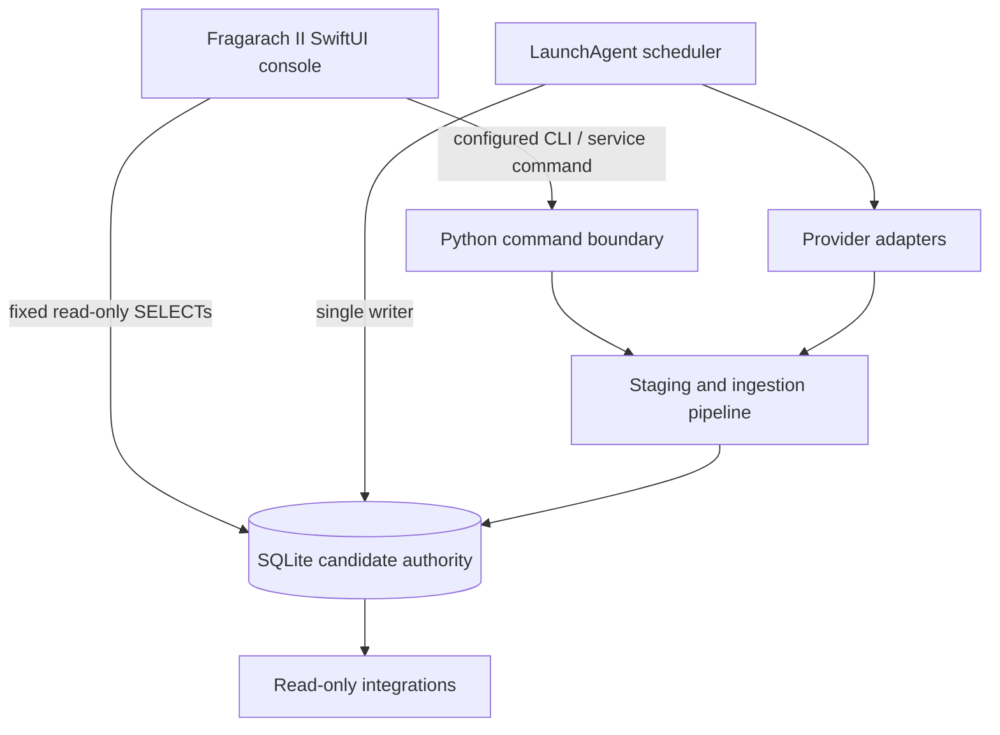
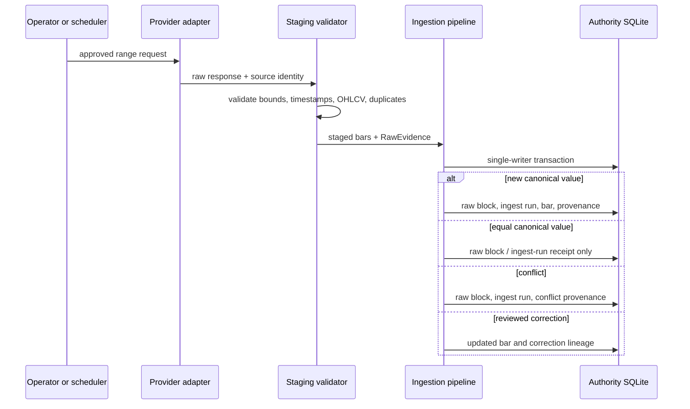
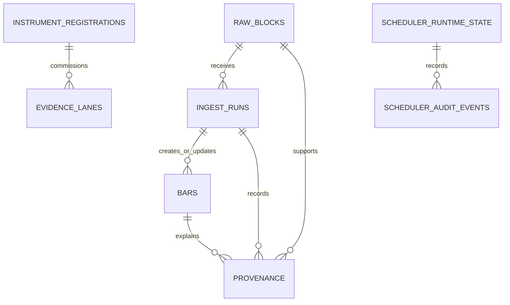
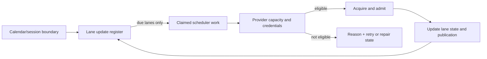
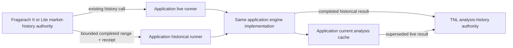

# Architecture and Data Flows

## Architecture

The authority database is the canonical evidence store. The scheduler journal,
LaunchAgent metadata, provider facts, and native presentation state are
operational supporting data, not alternate canonical evidence stores.

### Read-only replica publication

Fragarach_2 may publish committed governed OHLCV to explicitly approved
read-only replicas. The publisher is an independent localhost-only service with
its own client registry and compact publication store. It cannot acquire,
ingest, validate, repair, or mutate canonical evidence and does not share the
live authority SQLite file.

The Mac Studio remains the sole authority. Fragarach Lite on the MacBook pulls
fingerprinted immutable snapshots over private Tailscale HTTPS, verifies every
payload, lane, and authority fingerprint, atomically admits a local copy, and
serves a loopback-only read-only Market History contract. Ordered deltas remain
future work. See `docs/operations/READ_ONLY_REPLICA_CLIENTS.md`.

## Acquisition and admission flow

## Storage relationships

The `raw_blocks` table is a content-addressed evidence record. Its unique hash
prevents duplicate byte storage. `ingest_runs` records every admission attempt.
`provenance` is intentionally limited to events that change or challenge
canonical truth; no-change observations are not repeated there.

## Scheduler flow

Routine scheduler wakes use the lane update register rather than re-auditing
the whole estate. A full estate audit is an explicit or weekly maintenance
operation. Each completed normal boundary is scheduled once per lane; the
worker does not rerun an engine merely because a monitor refreshes.

## Result publication and consumers

Engine and presentation consumers must resolve the latest per-engine result,
not the most recent symbol-level cache object. A result identity includes at
least symbol, timeframe, CAODT, governed-input revision, engine scientific
version, execution ID, cache revision, status, and ranked candidates. A newer
engine version or cache revision invalidates a stale no-result presentation.

### Live and historical analysis boundary

The application owns both runners, engine execution, back-test scheduling,
current analysis caches, interpretations, reports, and its Live and History
interfaces. The live runner continues to use the established Fragarach history
call. The historical runner requests a bounded range whose end is exclusive
and whose independent `as_of_utc` cutoff prevents forward observation.

TNL does not request market history and does not operate application engines.
It stores superseded live analysis and completed historical-run evidence. It
stores the Fragarach receipt and ordered input fingerprint, not a copy of
Fragarach price history. When an application History interface needs price
context, the application requests that bounded context from Fragarach.

## Failure doctrine

The system never converts a failure into a successful-looking result. A
blocking state includes a stable reason code, supporting facts, scope, retry or
repair action, and ownership. Transient provider states use durable retry
times; credentials, mappings, and authority states require their named repair.
