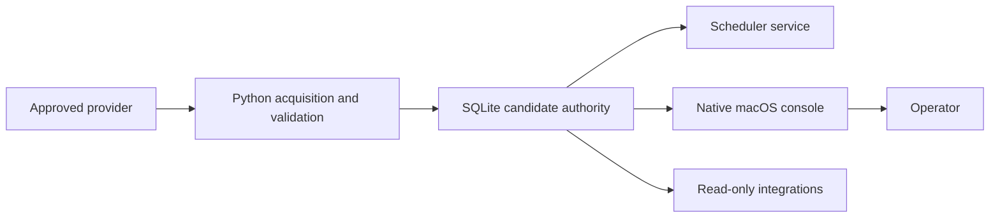

# Fragarach II Handbook

Fragarach II is a candidate authority for historical market-bar evidence. It
acquires, validates, stores, and serves market evidence; it does not make a
trading decision or represent trading readiness.

Use this handbook as the maintained operational documentation. Historical
specifications and acceptance reports remain under `docs/reports/` as evidence
of individual changes, not as the primary operating instructions.

| Document | Audience | Use it for |
| --- | --- | --- |
| [User manual](USER_MANUAL.md) | Operators | Running the macOS console and understanding its results |
| [Integration manual](INTEGRATION_MANUAL.md) | Consumers and automation authors | Safe read and command integrations |
| [Developer guide](DEVELOPER_GUIDE.md) | Contributors | Local setup, tests, and code ownership |
| [Architecture and data flows](ARCHITECTURE_AND_DATA_FLOWS.md) | Developers and reviewers | Authority boundaries, storage, and runtime flow |
| [Maintenance and troubleshooting](MAINTENANCE_AND_TROUBLESHOOTING.md) | Operators and maintainers | Backups, scheduler recovery, database growth, and repair |

## System at a glance

The authoritative database normally lives at
`data/runtime/spec002_real_evidence_acceptance.sqlite3`. The native app reads
it directly in read-only mode. Every mutation goes through the Python writer
boundary or the persistent scheduler service.

## Vocabulary

- **Canonical bar** — the currently accepted OHLCV record at one symbol,
  timeframe, and open time.
- **Raw block** — a content-addressed provider response, retained once by
  SHA-256 for replay and audit.
- **Provenance event** — evidence of an insert, preserved conflict, or explicit
  correction. An equal observation is an ingest outcome, not provenance.
- **CAODT** — the canonical as-of data time used when judging freshness.
- **Lane** — a commissioned `(symbol, timeframe)` evidence stream.
- **Candidate authority** — evidence is managed rigorously, but no claim is
  made about market suitability or trading outcomes.
